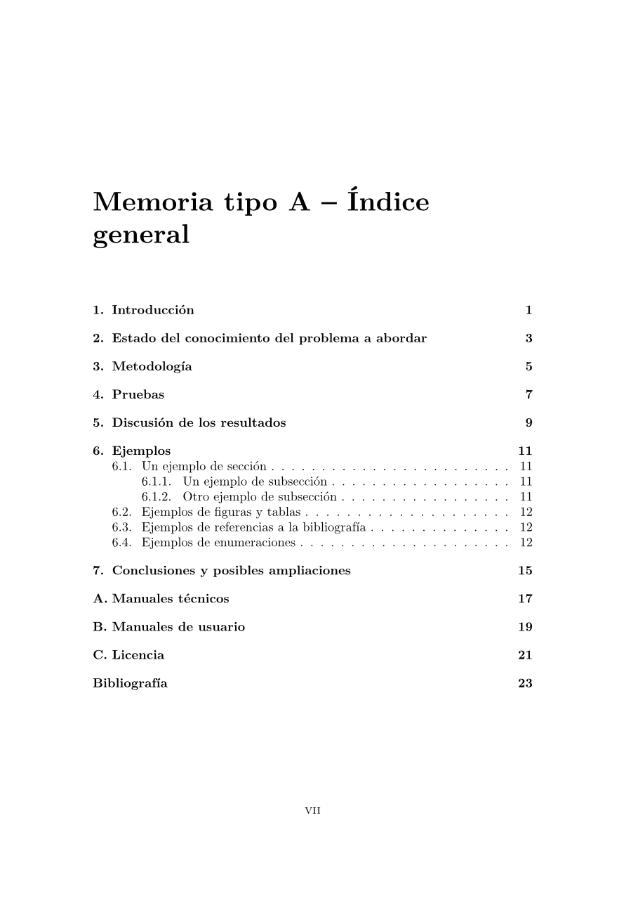
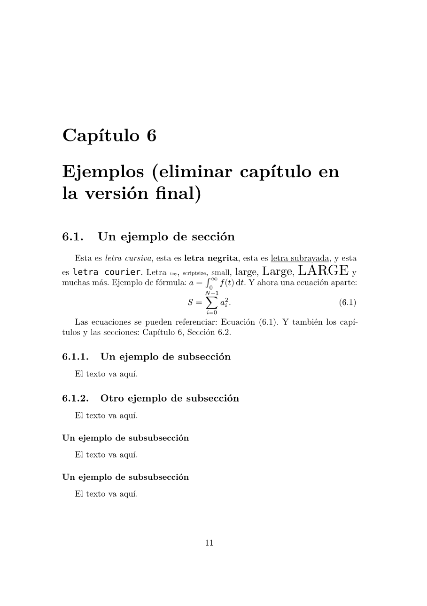
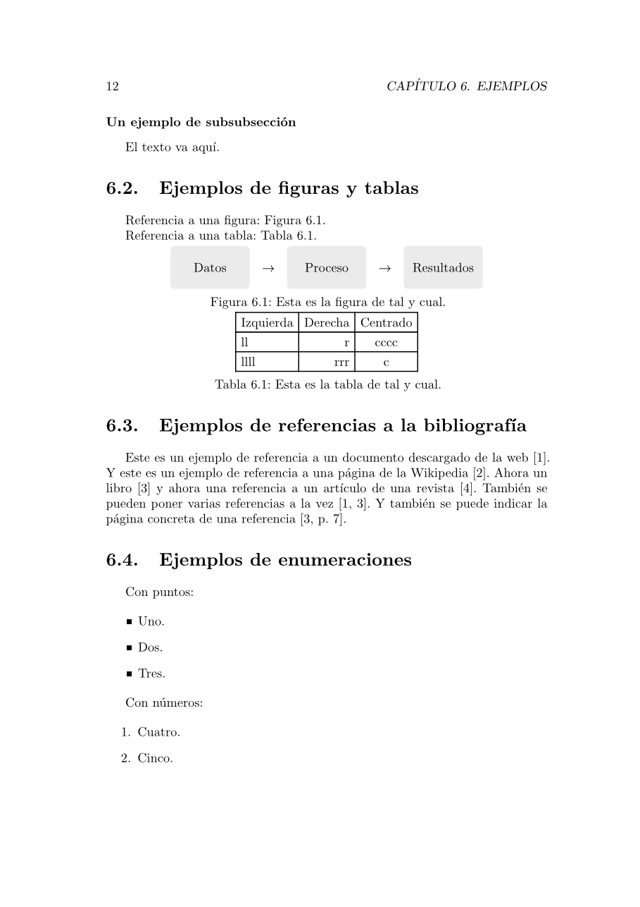

# xemelgo-etse

Unofficial Typst clone of the official LaTeX templates for the *Traballo de Fin de Grao* (TFG) report
of the *Grao en Enxeñaría Informática* (GrEI) at the *Escola Técnica Superior de Enxeñaría* (ETSE),
*Universidade de Santiago de Compostela* (USC).

> Plantilla **no oficial** en Typst que reproduce las plantillas LaTeX oficiales de la ETSE para la
> memoria del TFG del Grado en Ingeniería Informática (modelos A, B y C), en castellano, gallego o inglés.

This package is not affiliated with or endorsed by the USC or the ETSE. Check the official
regulations and templates of your degree before submitting your TFG.

<p>
  
  
  
  
</p>

## Usage

Create a new project from the template, in the web app (*Start from template*) or on the command line:

```sh
typst init @preview/xemelgo-etse:0.1.0
```

Or apply it to an existing document:

```typ
#import "@preview/xemelgo-etse:0.1.0": apendices, modeloA

#show: modeloA.with(
  title: [Título del Trabajo de Fin de Grado],
  authors: (
    (name: "Nombre del alumno"),                // first: the student
    (name: "Nombre del tutor"),                 // then: the tutors
    (name: "Nombre del cotutor", department: "Departamento de Física Aplicada"),
  ),
  logo: image("logo_usc.pdf"),
  abstract: [Breve resumen del trabajo.],
  bibliography: bibliography("refs.bib"),
)

= Introducción
...

#show: apendices

= Manuales técnicos
...
```

### The USC logo

The USC logo is not included in this package, because its terms of distribution are not public. You
can download it from the [USC corporate identity page](https://www.usc.gal/gl/usc/institucional/imaxe-corporativa),
add it to your project and pass it with `logo: image("logo_usc.pdf")`. Without a logo, the cover and
the certification page are laid out without it.

### Models

The ETSE provides three models of the report. They share the same layout and only differ in the table
of contents title and in the suggested chapters (see the [examples](#examples)).

| Function  | Model | Suggested chapters |
|-----------|-------|--------------------|
| `modeloA` | A: research work | Introducción, Estado del conocimiento, Metodología, Pruebas, Discusión de los resultados, Conclusiones |
| `modeloB` | B: software system | Introducción, Especificación de requisitos, Diseño, Pruebas, Conclusiones |
| `modeloC` | C: project / business study | Introducción, Análisis de las alternativas, Descripción del proyecto, Viabilidad, Conclusiones |

### Parameters

All three functions take the same parameters:

| Parameter          | Default | Description |
|--------------------|---------|-------------|
| `title`            | `[Title]` | Title of the TFG. |
| `subtitle`         | `none`  | Optional subtitle for the cover. |
| `authors`          | `()`    | Array of `(name: ..)` dictionaries: the student first, then the tutors. A tutor may have a `department` (default: *Departamento de Electrónica y Computación*). |
| `logo`             | `none`  | University logo as content, e.g. `image("logo_usc.pdf")`. See [the logo](#the-usc-logo). |
| `date`             | `auto`  | Date of the cover and the certification page, a `datetime`. `auto` is today. |
| `lang`             | `"es"`  | `"es"` (Spanish), `"gl"` (Galician) or `"en"` (English). Changes all the fixed texts. |
| `i18n`             | `(:)`   | Your own fixed texts, by language: `(es: (abstract: [Sinopsis]))`. Overrides any entry, or adds a whole language (see [`src/i18n.typ`](src/i18n.typ) for the keys, including `months`, `weekdays` and `date-format`). |
| `certification`    | `true`  | Tutors' certification page. |
| `acknowledgements` | `none`  | Content of the acknowledgements page, if any. |
| `abstract`         | `none`  | Content of the abstract page, if any. |
| `blank-pages`      | `true`  | Start every chapter on an odd page, with blank pages and mirrored margins, for printing. `false` gives a compact PDF with centred margins. |
| `code-style`       | `"latex"` | `"latex"`: code blocks as in the LaTeX template. `"wired"`: grey boxes with the language name, as in the [wired-ieee](https://typst.app/universe/package/wired-ieee) package. |
| `code-numbers`     | `false` | Line numbers in code blocks, with `code-style: "wired"`. |
| `bibliography`     | `none`  | A `bibliography(..)`. Printed in IEEE style, cited as `[1, 3]`. |

### Other functions

- `apendices`: use it as `#show: apendices` before the appendices. They are numbered A, B, C… and
  titled *Apéndice* (*Appendix* in English).
- `short-title`: a shorter title for the table of contents and the running header, for long chapter or
  section titles (like LaTeX's `\chapter[short]{long}`):
  `= A very long chapter title #short-title[Short title]`.
- `caratula`: the 12 × 12 cm CD cover label of the original template. It takes `title`, `authors`,
  `course`, `session`, `lang`, `i18n` and `logo`.

### What you get

- Cover, certification page, acknowledgements, abstract, table of contents and, only when the
  document has any, lists of figures and tables.
- Same page size, margins, fonts and spacing as the LaTeX templates (Computer Modern, 12 pt).
- Chapters starting on odd pages, running headers with the chapter and section, and the page number on
  the first page of each chapter.
- Lists, verbatim blocks and code listings spaced as in LaTeX. Code with a language
  (` ```c `) looks like LaTeX `listings`: roman font, bold keywords and italic comments.
- Figures, tables and equations numbered per chapter (*Figura 6.1*, *(6.1)*), and references such as
  `@label` printed as *Capítulo 6*, *Sección 6.2*, *Figura 6.1* or *Ecuación (6.1)*.

## Examples

- [`template/main.typ`](template/main.typ): model A, the file created by `typst init`.
- [`examples/modeloB.typ`](examples/modeloB.typ): model B.
- [`examples/modeloC.typ`](examples/modeloC.typ): model C.
- [`examples/caratula.typ`](examples/caratula.typ): CD cover.

## License

The library code is licensed under the [MIT license](LICENSE). The files in the `template` directory,
which are copied into your project, are licensed under the [MIT No Attribution license](LICENSE-MIT-0),
so you do not need to keep any notice in your TFG.
